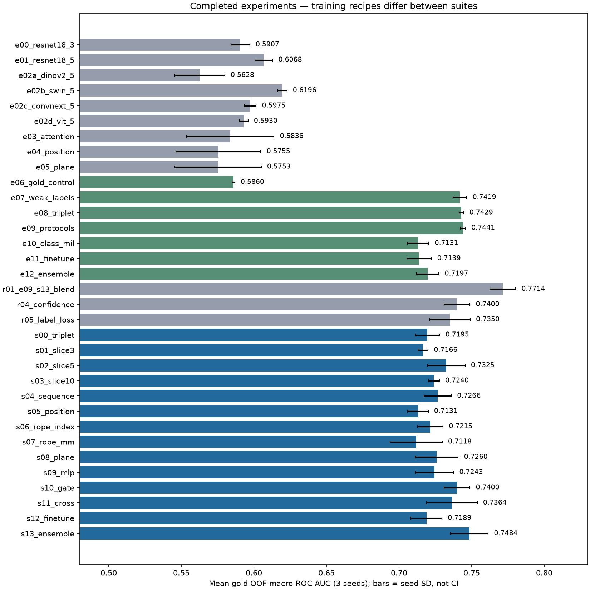
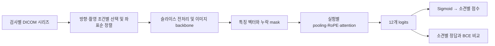

# RSNA Knee Abnormality Detection

**무릎 MRI의 12개 소견을 동시에 예측하는 다중 라벨 분류 실험 기록.**

ResNet baseline에서 시작해 backbone, 보고서 약라벨, 슬라이스 개수, 촬영 조건, 위치 인코딩, attention, fine-tuning, 앙상블을 단계별로 비교했다. 모델을 복잡하게 만드는 것과 실제 성능 개선을 구분하고, 평균 점수뿐 아니라 소견별 놓침과 오탐을 분석하는 프로젝트다.

[대회](https://www.kaggle.com/competitions/rsna-knee-abnormality-detection) · [실험 결과](docs/portfolio_results.md) · [소견별 혼동행렬](docs/results/2026-10-19/confusion_comparison.md) · [학습 과정과 평가지표](docs/training_and_metrics.md) · [얻은 경험과 한계](docs/project_purpose_and_learning.md)

진행 내용 업데이트: [GitHub와 VS Code 사용법](docs/github_workflow.md).

**대회 종료 정리 (2026-10-23):** [전체 진행 내용·완료 결과·후속 학습 상태](docs/competition_wrapup_20261023.md). 저장된 OOF 집계는 Kaggle 41개 구성과 로컬 R06 1개이며, 최고 기록 Public은 **0.805**, 개발 OOF는 V00의 **0.780610**이다. 검증 loss 기반 후속 파인튜닝은 정리 시점에 진행 중이다.

## 현재 결과

**Public Score (2026-10-22 사용자 제공 제출 화면): V02 slice blend v1 0.805, R01 E09/S13 blend v2 0.797, E02b Swin v1 0.688, baseline v1 0.642.** 화면에서 V02가 선택돼 있다. 중복 제출을 포함한 5건의 버전·선택 상태는 [Public Score 기록](docs/notebook_run_results.md)에 남겼다.

**아래는 2026-10-19 기준 33개 실험 구성의 비교다.** 당시 최고 개발 OOF macro AUC는 R01 고정 앙상블의 **0.771432**였다. 이후 T00–T02·V00–V04·로컬 R06을 포함한 [42개 구성 집계](docs/results/2026-10-23/experiment_metrics.csv)는 별도로 보존했다. 아래 수치는 Kaggle 리더보드 점수나 정확도가 아니다.

| 비교 | OOF macro AUC 평균 | 관찰 |
|---|---:|---|
| E06 gold-only → E07 보고서 약라벨 | 0.585972 → 0.741941 | 현재까지 가장 큰 개선은 감독 신호 확대 |
| S01 인접 3장 → S02 5장 → S03 10장 | 0.716563 → 0.732541 → 0.724005 | 장수를 늘려도 항상 좋아지지 않음 |
| S08 → S11 cross-attention | 0.725969 → 0.736386 | 같은 부모 모델 대비 개선 |
| S11 → S12 backbone 일부 fine-tuning | 0.736386 → 0.718888 | 이 설정의 fine-tuning은 악화 |
| S13 → R01 E09/S13 고정 앙상블 | 0.748420 → 0.771432 | 서로 다른 구성의 예측을 결합 |

평가: **gold 58건, 동일 3 folds × seeds 42/2026/3407**. seed별 전체 OOF AUC를 계산한 뒤 평균했다. 같은 58건을 반복 사용한 개발 검증이며, 공개 약라벨 teacher의 gold 독립성은 입증되지 않았다. 서로 다른 학습 조건의 모든 행을 단일 누적 개선 곡선으로 해석하지 않는다.



## 모델과 실험 흐름



- **E 계열:** ResNet18, DINOv2, Swin-T, ConvNeXt, ViT 비교 → 약라벨 → 2.5D 입력과 촬영 조건 → MIL/부분 fine-tuning.
- **S 계열:** 인접 3/5/10장, slice self-attention, index/mm RoPE, 방향 embedding, gate/cross-attention, 앙상블.
- **R 계열:** 오류 분석을 바탕으로 앙상블, 입력 범위, 약라벨 confidence, loss reduction, fine-tuning 조건 비교. R01/R04/R05와 로컬 R06 완료.
- **T 계열:** 방향 × slice 깊이 위치 표현 T00–T02 완료. OOF AUC는 각각 0.722923 / 0.733206 / 0.716154.
- **V 계열:** 고정 blend, slice dropout, seed head 평균 V00–V04의 OOF 평가 완료. V02의 기록된 Public 점수는 0.805.
- **U 계열:** 물리적 crop, IOP 방향 정규화, 평균 전 공간 attention, 전체 backbone 1/3 epoch, TTA와 앙상블. **코드와 자동 큐 준비 완료, GPU 학습 결과는 아직 없음.** [상세 계획](docs/public_method_experiments.md)

## 저장소 구성

| 경로 | 내용 |
|---|---|
| `train_baseline.py` | 초기 ResNet 특징 + Linear 분류기 |
| `experiments/` | 공통 전처리, 모델, 학습·추론, notebook 생성기 및 실행기 |
| `notebooks/` | 실험별 독립 학습 notebook과 Internet OFF 제출 notebook |
| `scripts/` | PowerShell 자동 실행, 오류 분석 및 공개 코드 조사 |
| `tests/` | 정답 정렬, mask, 데이터 누출 방지, 학습/추론 일치, 실행 재개 검증 |
| `docs/` | 실험 설계, 결과 해석, 공개 코드 조사, 학습 개념 설명 |
| `docs/results/2026-10-19/` | 데이터 없이 확인 가능한 집계 성능표와 혼동행렬 |

원본 DICOM, 보고서 원문, 검사별 정답·예측, 모델 가중치, `.venv`, 인증 토큰, 실행 상태·캐시는 저장소에 포함하지 않는다. 공개 결과는 저장된 OOF에서 재계산한 집계이며, 출처·파일 hash는 [snapshot.json](docs/results/2026-10-19/snapshot.json)에 기록했다.

## 실행과 재현 범위

**RTX 5090 로컬 파인튜닝:** [로컬 GPU 학습 안내](docs/local_gpu_training.md). 별도 CUDA 환경을 준비한 뒤 `scripts/run_local_training.ps1 -Mode check`, `-Mode smoke`, `-Mode train` 순서로 R06을 실행한다. 영상 데이터와 S11 train v1의 모델·특징 캐시가 필요하며, 실행 중인 Kaggle 큐와 별도 출력에 저장한다.

Windows PowerShell 환경 예시:

```powershell
python -m venv .venv
.\.venv\Scripts\python.exe -m pip install -r requirements.txt
# 결과 시각화까지 사용할 경우
.\.venv\Scripts\python.exe -m pip install -r requirements-analysis.txt
```

기존 실험은 Kaggle GPU에서, 로컬 후속 파인튜닝은 RTX 5090에서 진행했다. 아래는 기존 Kaggle 재현 절차이며 대회 종료 후 공식 제출 가능 여부는 확인하지 않았다. 데이터 접근 권한을 확보하고, 원하는 실험의 `train.ipynb`와 완료된 학습 출력에 연결한 `submit.ipynb`를 사용한다. **제출 notebook은 GPU ON / Internet OFF로 실행하며, 제출 대상은 `submission.csv`다.** Notebook metadata의 계정과 선행 output 버전은 실행할 계정에 맞게 설정해야 한다.

생성된 notebook에는 전체 코드와 실험 설정이 들어 있다. 다만 일부는 선행 실험 출력이나 보고서 약라벨 dataset을 입력으로 요구한다. `R/T/U` 자동 실행기는 작성자의 기존 실행 상태·선행 결과를 검증해 이어가는 용도이며, 공개 저장소를 clone하는 것만으로 기존 개인 Kaggle 출력에 접근하거나 모든 큐를 재개할 수 있는 것은 아니다. 데이터 준비와 입력 연결은 아래 문서를 참고한다.

2026-10-23 병합 전 검증에서 전체 **125개 중 CPU 121개 통과, GPU 전용 4개 건너뜀**을 확인했다. 별도 GPU 환경에서는 해당 4개를 포함한 관련 테스트 10개가 모두 통과했다. 전체 suite 중 일부는 저장소에서 제외한 기존 학습 artifact를 요구한다. 해당 artifact가 준비된 환경의 검증 명령은 다음과 같다.

```powershell
.\.venv\Scripts\python.exe -X utf8 -m unittest discover -s tests -v
.\.venv-5090\Scripts\python.exe -X utf8 -m unittest tests.test_local_early_stopping tests.test_public_finetuning tests.test_public_finetuning_queue -v
```

집계 자료로 혼동행렬 비교 화면을 다시 생성하려면:

```powershell
.\.venv\Scripts\python.exe -X utf8 -m scripts.compare_confusions --output docs/results/2026-10-19
```

HTML 비교 화면은 내려받아 브라우저에서 열 수 있다. GitHub에서는 Markdown 보고서와 PNG 그림을 바로 볼 수 있다. `requirements.txt`는 직접 의존성 목록이고 완전한 버전 lock이 아니며, Kaggle 실행 환경은 notebook metadata에서 지정한다.

## 상세 실험 기록

- [대회 종료 정리와 42개 구성 집계](docs/competition_wrapup_20261023.md)
- [공개 파인튜닝 방법 7개 계열·점수 근거 조사](docs/kaggle_finetuning_evidence_20261023.md)
- [RTX 5090 실행·early stopping·후속 학습 큐](docs/local_gpu_training.md)
- [실험별 학습·제출 사용법과 전체 Notebook 목록](docs/experiment_notebooks.md)
- [터미널 한 번으로 다음 실험 자동 실행](docs/automatic_experiments.md)
- [실제 Kaggle 실행 결과와 모델 비교](docs/notebook_run_results.md)
- [대회 목적, 데이터, loss와 평가지표](docs/training_and_metrics.md)
- [프로젝트의 최종 목적과 얻을 경험·포트폴리오 회고](docs/project_purpose_and_learning.md)
- [Backbone 후보 조사](docs/backbone_research.md)
- [Most Votes 공개 Notebook 조사와 적용 후보](docs/kaggle_most_voted_review.md)
- [공개 0.95 계열 25개 원문 검토·우리 방식과의 차이·다음 실험 계획](docs/kaggle_095_twenty_notebook_review.md)
- [우리 실험일지 Notebook와 Kaggle 게시 상태](docs/kaggle_experiment_journal_publication.md)
- [보고서 약라벨·2.5D·부분 fine-tuning 자동 실험](docs/weak_label_experiments.md)
- [기존 학습 종료 후 인접3/5/10장·RoPE·cross-attention 자동 실험](docs/spatial_experiments.md)

각 `notebooks/experiments/<실험 ID>/` 아래의 `train/train.ipynb`와 `submit/submit.ipynb`가 한 쌍이다. 두 Notebook 모두 독립적인 전체 코드다. **대회 제출 화면에서는 `submission.csv`가 출력된 완료된 submit 버전을 선택한다.**

E03→E04→E05를 자동으로 Kaggle에 업로드하고 학습·제출 파일 생성·결과 회수까지 진행하려면:

```powershell
powershell.exe -NoProfile -ExecutionPolicy Bypass -File .\scripts\run_experiments.ps1
```

같은 명령으로 중단 지점부터 재개한다. 실행 로그와 비교표는 `outputs/automation/next-experiments/`에 저장한다. Codex 호출은 필요 없다.

로컬 점검은 기존 `.venv`를 사용한다.

```powershell
.\.venv\Scripts\python.exe -m pip install -r requirements.txt
.\.venv\Scripts\python.exe -m unittest discover -s tests -v
```

GPU 학습 실행과 학습 버전 연결 명령은 위 사용법에 있다. API 토큰은 Notebook이나 저장소 파일에 넣지 않는다. 기존 `train_baseline.py`와 `notebooks/submission/`은 초기 baseline이며 새 실험과 별도로 보존한다.

방향 × slice 깊이 positional encoding 실험은 [실험노트](docs/plane_depth_position_experiment.md)에 정리했다. T00 기존 구조 재현 → T01 깊이 추가 → T02 방향·깊이 결합을 비교했다. [과거 실행 기록](docs/plane_depth_execution_log.md)과 이후 완료된 [T00–T02 집계](docs/results/2026-10-23/experiment_metrics.csv)를 구분한다.

공개 고득점 코드는 [Hotness·Most Votes 재조사 및 공식 점수 대조](docs/kaggle_hotness_votes_095_refresh.md)에서 확인할 수 있다. 상위 40개 목록, 기존 25개 검토의 공식 최고점, nartaa의 실제 학습 조건과 우리 구조의 차이를 정리했다.
