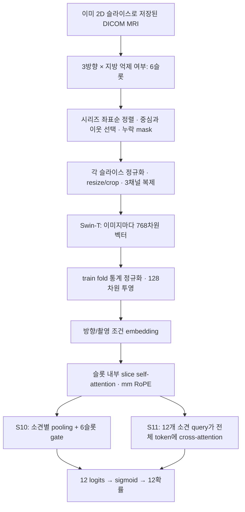

# MRI 실험 노트: 혼동행렬, attention, 약라벨, 다음 실험

> GitHub 공개용 최신 집계: [33개 완료 실험 결과](portfolio_results.md) · [데이터 없이 볼 수 있는 혼동행렬](results/2026-10-19/confusion_comparison.md). 아래는 실험 당시의 기록이며 `../outputs/` 링크는 작성자의 로컬 산출물 경로다.

[이 실험을 통해 얻을 경험과 프로젝트 회고](project_purpose_and_learning.md)

작성 2026-10-19. E00~E12·S00~S13 **30개 완료 구성**의 저장된 예측으로 다시 계산했다. 추가 R01의 원격 OOF 계산도 완료됐으며 실행 상태와 결과를 맨 아래에 기록한다. 이 문서의 AUC는 **Gold58 개발 OOF**이며 Kaggle 리더보드 점수가 아니다.

**먼저 열어볼 파일:** [두 실험을 선택하는 혼동행렬 비교 HTML](../outputs/analysis/2026-10-19/confusion_comparison.html). 기존30개+완료된 R01을 포함한다. 브라우저로 열면 실험 A/B를 바꾸며 12개 소견의 TN/FP/FN/TP·재현율·정밀도·AUC를 비교할 수 있다. 인터넷 연결 없이 동작한다.

- [전체 실험 표와 개별 혼동행렬 그림](../outputs/analysis/2026-10-19/confusion_comparison.md)
- [각 소견의 부모 실험 대비 변화 CSV](../outputs/analysis/2026-10-19/parent_category_deltas.csv)
- [모든 seed의 소견별 원본 수치 CSV](../outputs/analysis/2026-10-19/category_metrics_all_seeds.csv)
- [기존 전체 결과·오류 분석](experiment_error_analysis.md)

## 1. TN, FP, FN, TP는 무엇인가

이 대회에서는 MRI 한 검사에 여러 소견이 동시에 있을 수 있다. 따라서 12개 클래스 중 하나만 고르는 12×12 행렬 대신 **소견마다 독립적인 2×2 행렬**을 만든다. 여기서 양성은 해당 소견이 있다는 뜻이다. 예를 들어 ACL이 음성이어도 다른 소견은 양성일 수 있다.

| 실제 정답 ↓ / 모델 판정 → | 소견 없음(0) | 소견 있음(1) |
|---|---|---|
| 소견 없음(0) | **TN — True Negative:** 없다고 정확히 판단 | **FP — False Positive:** 없는데 있다고 판단, 오탐 |
| 소견 있음(1) | **FN — False Negative:** 있는데 없다고 판단, 놓침 | **TP — True Positive:** 있다고 정확히 판단 |

True/False는 **판정의 정오**, Positive/Negative는 **모델이 내린 판정**이다. FN의 Negative가 실제 정상이라는 뜻은 아니다. 예측 확률이 0.5 이상이면 1, 미만이면 0으로 판정했다. 그림은 행=실제, 열=예측이며 색/퍼센트는 실제 정답 행 안의 비율이다. [공식 다중 레이블 혼동행렬 정의](https://scikit-learn.org/stable/modules/generated/sklearn.metrics.multilabel_confusion_matrix.html)

**재현율 Recall = TP / (TP + FN)**: 실제 소견이 있는 검사를 얼마나 찾아냈는가? 분모가 실제 양성이다. 실제 양성 23건 중 6건을 찾고 17건을 놓쳤으면 6/23=26.1%다. 재현율을 높이려면 놓치는 FN을 줄여야 한다.

**정밀도 Precision = TP / (TP + FP)**: 모델이 소견 있다고 한 검사 중 실제로 맞는 것은 얼마인가? 분모가 예측 양성이다. 양성이라고 한 16건 중 6건만 맞고 10건은 오탐이면 6/16=37.5%다. 정밀도를 높이려면 양성 판정에 섞이는 FP를 줄여야 한다. 양성 판정 자체가 0건이면 정밀도는 정의되지 않으며 CSV/화면에서 결측으로 표시한다.

위 예시는 **S13의 외측 반월상연골**이다. TN=25, FP=10, FN=17, TP=6이다. 전체 정확도 (TN+TP)/58=53.4%만 보면 무엇이 문제인지 덜 드러나지만, 재현율을 보면 실제 이상 대부분을 놓친다는 점이 드러난다.

반대로 S13의 관절액 증가는 TP=35, FN=0으로 재현율 100%지만 FP=13이다. 양성이라고 한 48건 중 35건만 맞으므로 정밀도는 72.9%다. **재현율 100%가 완벽한 모델이라는 뜻은 아니다.** 특이도 TN/(TN+FP)=10/23=43.5%여서 정상 검사를 양성으로 많이 판정한다.

임계값을 낮추면 같은 예측 확률에서 TP와 FP는 줄지 않고 FN과 TN은 늘지 않는다. 재현율은 올라갈 수 있지만 정밀도는 반드시 좋아지는 것이 아니다. 대회 주지표인 **macro ROC AUC**는 양성의 확률이 음성보다 높게 정렬되는지를 소견별로 평가해 평균한다. 임계값 하나를 조정하는 것과 구별 능력을 개선하는 것은 별개다. 제출 파일에는 0/1 판정 대신 **원래 확률 12개**를 저장한다. [공식 임계값 설명](https://scikit-learn.org/stable/modules/classification_threshold.html)

## 2. 비교 조건과 전체 변화

혼동행렬은 모두 **같은 Gold58, 같은 3-fold, seed42, 임계값0.5**다. 각 검사는 해당 검사를 학습하지 않은 fold 모델의 예측으로 평가했다. AUC 평균은 seed42/2026/3407 각각의 OOF AUC를 평균했다. 58건을 3회 평가한 것이지 174명의 독립 표본이 아니다. 소견 합산 수치는 58×12=696개 판정이며, 소견 간 상관관계가 있다.

| 비교 | AUC 평균 | FN 합 | FP 합 | 관찰 |
|---|---:|---:|---:|---|
| E06 gold 대조 → E07 약라벨 | .5860 → .7419 | 124 → 83 | 103 → 129 | 양성을 더 찾으면서 오탐도 증가. 가장 큰 AUC 개선 |
| E09 촬영 조건 → E10 소견 MIL | .7441 → .7131 | 75 → 89 | 144 → 135 | 이 attention 구성은 놓침 증가와 AUC 하락 |
| S01 인접3 → S02 인접5 | .7166 → .7325 | 81 → 78 | 141 → 131 | 두 오류가 함께 감소 |
| S02 인접5 → S03 인접10 | .7325 → .7240 | 78 → 86 | 131 → 137 | 전체는 악화, 소견별 방향은 다름 |
| S02 → S04 slice self-attention | .7325 → .7266 | 78 → 75 | 131 → 138 | 놓침은 줄고 오탐 증가, AUC는 하락 |
| S07 mm RoPE → S08 방향 embedding | .7118 → .7260 | 85 → 81 | 158 → 136 | 방향/촬영 조건 구별에 이득 |
| S08 → S10 gate | .7260 → .7400 | 81 → 78 | 136 → 140 | AUC와 놓침 개선, 오탐 소폭 증가 |
| S08 → S11 cross-attention | .7260 → .7364 | 81 → 78 | 136 → 144 | AUC 개선, gate보다 평균 AUC 낮음 |
| S11 → S12 일부 FT | .7364 → .7189 | 78 → 76 | 144 → 149 | 재현율 일부 개선과 별개로 순위 성능 하락 |
| S11 → S13 고정 앙상블 | .7364 → .7484 | 78 → 75 | 144 → 144 | 현재 최고 평균 AUC |

E00~E05는 gold58·head5epoch, E06 이후는 head20epoch 등 조건이 바뀐다. E06→E07이 데이터 확대 효과를 분리하는 비교다. S00도 E10에서 후단 구조·batch 등이 바뀐 새 기준이다. 각 실험을 이전 번호와 무조건 비교하면 안 된다. 위치 실험 S05/06/07은 S04의 분기, 융합 S09/10/11은 S08의 분기다.


### 합산 행렬만 보면 놓치는 차이

E09와 S13은 우연히 **TN312/FP144/FN75/TP165**로 합계가 동일하다. 그렇다고 같은 예측은 아니다.

| 소견 | E09 FN / FP | S13 FN / FP | 해석 |
|---|---:|---:|---|
| ACL | 13 / 8 | 7 / 9 | S13이 양성 6건을 더 찾지만 오탐1건 증가 |
| 내측 반월상연골 | 4 / 18 | 7 / 12 | 오탐6건 감소, 놓침3건 증가 |
| 외측 반월상연골 | 14 / 7 | 17 / 10 | S13이 두 오류 모두 증가 |
| 슬개대퇴 OA | 3 / 16 | 7 / 12 | 더 보수적인 판정, 놓침 증가 |
| 관절액 증가 | 3 / 12 | 0 / 13 | S13이 놓침을 없애고 오탐1건 증가 |
| 골절 | 12 / 6 | 11 / 6 | 둘 다 양성을 많이 놓침 |

따라서 전체 AUC와 함께 **MCL, 외측 반월상연골, 골절의 AUC·FN·FP**를 우선 추적한다. 서로 다른 모델의 오류가 보완되는지는 고정 앙상블 R01로 확인한다. 소견마다 최고 모델을 골라 섞는 탐색은 이 58건에 과적합할 위험이 있어 이번에는 하지 않는다.

## 3. 지금 ResNet인가, Transformer인가? Attention이 효과가 없었나?

현재 S 계열의 이미지 backbone은 **Swin-T Transformer**다. 처음 ResNet18을 썼던 E00/E01에서 이미 바뀌었다. 이미지 내부의 특징 추출과 여러 이미지 사이의 결합은 서로 다른 단계다.



MRI 전체를 임의의 새 방향으로 다시 잘라 만드는 구현은 아니다. 대회가 제공한 Sagittal/Coronal/Axial **원래 시리즈**를 읽는다. 가능한 경우 DICOM `ImageOrientationPatient`와 `ImagePositionPatient`로 순서와 상대 mm 위치를 얻고, 없으면 InstanceNumber를 사용한다. S02/S03의 기존 기록은 모든 선택 token에 물리 좌표가 있었다.

- **S04**는 한 슬롯 내부에서 슬라이스 벡터끼리 self-attention을 한다. 이미지 안의 patch attention인 Swin과는 별개다.
- **S05**는 일반 sin/cos 위치 표현, **S06**는 index RoPE, **S07**은 상대 mm RoPE를 비교했다. RoPE는 위치에 따라 Q/K를 회전시키는 **Rotary Position Embedding**이다. 원본 index/mm를 보존하며 누락 token은 mask한다.
- **S08**은 방향과 촬영 조건 embedding을 추가한다. 이 정보만으로 어떤 방향이 항상 우월하다고 선언할 수는 없다.
- **S10**은 소견별로 각 슬롯의 슬라이스를 모은 뒤, 6슬롯을 gate로 가중합한다.
- **S11**은 12개 학습 가능한 소견 query가 **6슬롯의 모든 유효 슬라이스 token**에 cross-attention한다. 단순 concat 대신 필요한 token에서 정보를 읽고 residual·LayerNorm·FFN을 거친다.
- **S13**은 S11/S12의 최종 확률을 반씩 평균한다. 하나의 새 attention 구조가 아니다.

**결론:** self-attention·RoPE를 넣는 것만으로는 이 설정에서 개선되지 않았다. 방향 embedding과 gate/cross-attention 결합은 해당 부모 대비 개선됐다. 그러나 전체 변경을 합한 S11이 단순 E09보다 좋지는 않았다. “Transformer이므로 무조건 우월하다” 또는 “attention이 쓸모없다” 둘 다 현재 증거보다 강한 결론이다.

Cross-attention도 정보를 완벽히 보존하지는 않는다. Swin에서 이미 이미지별 전역 특징으로 줄였고, 후단에서 768→128로 투영하며, 마지막에는 소견별 벡터로 모은다. “concat을 없애서 정보가 전혀 안 뭉개진다”는 뜻은 아니다. 현 실험은 patch-level 3D cross-attention이 아니라 **slice-level 특징 결합**이다. attention weight만으로 방향의 인과적 우열을 입증할 수도 없다. 향후 방향 제거 비교는 고정 모델에서 방향을 가린 진단과, 같은 조건으로 해당 방향 없이 재학습하는 ablation을 구분해야 한다.

관련 코드: [슬라이스 선택·RoPE·SpatialHead](../experiments/spatial_core.py), [학습·OOF·FT](../experiments/spatial_train.py), [초기 E 계열](../experiments/core.py).

## 4. 약라벨링은 무엇인가

**정확한 영상 정답을 직접 추가 확보한 대신, MRI 판독 보고서에서 자동 추출한 불완전한 감독 신호로 학습량을 늘리는 것**이다. 현재는 공개 `pilkwang/rsna-knee-llm-labels` 자료의 보고서 기반 soft target·YES/NO/UNK·confidence를 사용한다. 영상 모델이 스스로 만든 pseudo-label을 다시 쓰는 방식과는 다르다.

1. Gold58은 제공된 확정 0/1 정답이다.
2. 나머지 검사 보고서에서 소견별 YES/NO/UNK와 soft score·confidence를 얻는다. 보고서가 침묵한 소견은 실제 음성이라고 단정할 수 없다.
3. 학습 입력은 MRI다. 보고서 기반 값은 **검사 단위 target/weight**로만 사용한다. 각 슬라이스마다 병변 위치 정답이 붙은 것이 아니다.
4. 골드 weight=3, known weak weight=`0.25+0.75×confidence`, UNK weight=0이다. known의 score를 유지하므로 항상 0/1 hard label은 아니다.
5. Gold와 보고서 내용이 겹치는 weak4건과 알려진 소견이 하나도 없는53건을 제외해 **weak4,292+gold58=4,350건**을 사용했다. 최종 추론에는 보고서가 필요 없다.

기존 학습 loss는 `sum(weight × BCEWithLogits) / sum(weight)`다. BCE는 12개 독립 소견의 정답과 예측 logits를 비교한다. 소견별 감독 수가 다르면 전체 loss에 주는 영향도 달라진다. R05는 각 소견 내부에서 먼저 weight 합으로 나누고, 유효 소견들을 동일하게 평균한다. batch에 유효 라벨이 없는 소견은 제외한다. UNK를 음성으로 바꾸지 않는다.

약라벨은 데이터 확대에 큰 도움이 됐지만 오류·누락·편향도 포함한다. 예를 들어 활막염은 weak4,292건 중 **3,614건이 UNK**, 알려진678건 중 YES564건이다. 골절은 YES295/NO1,594/UNK2,403이다. 보고서의 미기재와 실제 음성은 다르므로 이 분포를 그대로 전체 환자 유병률로 해석하지 않는다. 공개 teacher가 gold와 독립적으로 만들어졌는지도 확립되지 않았다.

R04는 confidence<0.8인 **known weak의 loss weight만0**으로 바꾼다. 원래 검사 population과 이미지 캐시, gold weight, target 값은 그대로 둔다. 품질이 높아질 수 있지만 드문 소견의 감독도 줄어들 수 있다. 그래서 제거된 YES/NO와 남은 weight를 소견마다 기록한다. confidence는 정확도가 보장된 확률이 아니므로 0.8 이상을 진짜 정답으로 취급하지 않는다.

## 5. 왜 이웃 5장이 10장보다 좋았을까?

### 관찰한 사실

S02/S03은 각 시리즈 길이의 25~75%에 **중심5개**를 놓고, 중심 주변의 이웃을 5장 또는10장 선택한다. 겹친 index는 제거하고 순서를 유지한다. 5장은 중심±2, 10장은 현재 구현상 중심−4~+5다. 짧은 시리즈에서는 clipping과 중복 제거로 실제 장수가 더 적다.

| 항목 | S02 이웃5 | S03 이웃10 |
|---|---:|---:|
| 슬롯당 최대 single token | 25 | 50 |
| 4,350검사 전체 실제 선택 token | 409,239 | 526,504 |
| 검사당 평균 token, 6슬롯 합계 | 94.1 | 121.0 |
| 특징 추출 시간 | 4.60시간 | 5.52시간 |
| OOF AUC 평균 | .732541 | .724005 |
| 검증 BCE | .614176 | .640817 |
| seed42 FN / FP | 78 / 131 | 86 / 137 |

이웃 장수는2배지만 중복 제거 뒤 실제 입력은 **약28.7% 증가**했다. 둘 다 5개 중심을 쓰므로 “정확히 같은 범위의 해상도만2배”도 아니다. 이웃을 늘리면서 끝의 포함 범위도 일부 넓어진다.

| 소견 | 5장 평균 AUC | 10장 평균 AUC | 10장−5장 |
|---|---:|---:|---:|
| 내측 반월상연골 | .7620 | .6823 | **−.0797** |
| 내측 OA | .8920 | .8444 | **−.0475** |
| MCL | .6077 | .6425 | **+.0348** |
| 골절 | .5991 | .6236 | **+.0245** |
| 골좌상 | .7436 | .7665 | **+.0229** |

외측 반월상연골은 seed42에서 5→10장으로 FP가 **8→17**, FN은 **15→14**였다. 더 넓게 양성이라고 판정하면서 한 건을 더 찾았지만 오탐9건이 추가됐다. MCL과 골절은 평균 AUC가 올라도 seed42·0.5에서 FN은 각각1건/2건 증가했다. AUC와 특정 경계의 재현율이 같은 지표가 아니라는 실제 예다.

5장−10장의 평균 AUC 차이 +.00854에 대한 검사 단위 paired bootstrap 95% 구간은 **−.01459~+.03309**로0을 포함한다. 5장이 일반적으로 우월하다고 확정할 표본은 부족하다. 이 구간 역시 반복 실험 선택과 재학습 변동을 모두 반영한 것은 아니다.

### 가능한 원인과 다음 확인 방법

| 가설 — 아직 입증하지 않음 | 관찰과 연결 | 확인 실험 |
|---|---|---|
| 주변의 덜 유용한 슬라이스가 소견 신호와 섞인다 | 내측 반월상연골/OA 하락, 외측 반월상연골 FP 증가 | 이웃5 고정, **범위만 넓히는 R02** |
| 필요한 병변을 중심 사이에서 놓친다 | 국소 소견에는 이웃 증가가 일부 도움 가능 | 범위 고정, **중심5→9인 R03** |
| 소견마다 필요한 범위가 다르다 | MCL·골절·골좌상은10장에서 AUC 상승 | 12개 AUC/FN/FP를 따로 보고, 공통 최고 모델만으로 결정하지 않기 |
| 약라벨 노이즈가 더 많은 token 선택과 상호작용한다 | 검사 단위 감독만 있고 slice 위치 정답은 없음 | 먼저 **R04 감독 신뢰도**, **R05 소견별 loss** 단독 비교 |
| 압축/최적화 용량이 많은 token에 부족하다 | 동일128차원 후단·20epoch·update수, 입력 수만 증가 | R02/R03 결과 후 필요할 때만 hidden_dim 또는 head epoch 하나씩 확대 |
| 58건에서 생긴 표본/초기화 변동이다 | paired 구간이0 포함 | 후보를 고정한 후 사전 정의된 대체 split 검증; 독립 검증 데이터가 생기면 최종 확인 |

R02/R03도 완벽하게 토큰 수를 일치시키는 비교는 아니다. 중복 제거 때문에 실효 장수가 달라질 수 있어 **실제 선택 index 범위·유효 token·mask 비율**을 함께 기록한다. 입력 범위와 감독을 확인하기 전에 무조건 epoch/모델 크기를 늘리지 않는다.

## 6. 이번에 자동 실행할 후속 실험

공통: 기존 완료 모델 버전 고정, Swin-T, Gold58 동일 fold/3seed, head20epoch. 각 R은 부모에서 독립적으로 변경한다. 앞 R의 결과를 다음 R에 자동 누적하지 않는다.

| 실행순서 | ID | 비교 부모 | 바꿀 한 요소 | 검증할 질문 |
|---:|---|---|---|---|
| 1 | R01 | E09·S13 | 확률 고정50:50 | 서로 다른 오류가 보완되는가? 실제 leaf 가중치 E09=.5/S11=.25/S12=.25 |
| 2 | R04 | S10 | known weak confidence<.8 weight0 | 낮은 신뢰도 감독이 오탐/놓침을 유발하는가? |
| 3 | R05 | S10 | 소견별 weight 합으로 BCE 정규화 | 희소 소견의 유효 학습 기여가 부족한가? |
| 4 | R02 | S10 | 중심 범위25~75%→10~90% | 더 넓은 범위를 보아야 하는가? 이웃5/중심5 유지 |
| 5 | R03 | S10 | 중심5→9 | 같은 범위를 더 촘촘히 보아야 하는가? 범위25~75%/이웃5 유지 |
| 6 | R06 | S12 | weak-only head1epoch 워밍업 추가 | 새 head와 backbone의 동시 시작이 불안정했는가? |
| 조건부 | R07 | R06 | FT1→3epoch | 초기화 개선 후에도 FT가 덜 수렴했는가? |

R06/R07은 **원래 S11의 frozen encoder**에서 각각 시작한다. Gold 전체를 본 S11 최종 head를 가져오지 않고 새 head를 weak train3,835건으로 워밍업한다. weak validation457건과 gold58건은 워밍업에 사용하지 않는다. FT checkpoint는 weak validation BCE로 고른다. 이후 encoder를 고정하고 모든 특징을 다시 추출해 원래 gold OOF head 평가를 수행한다.

R07은 R06이 S12 대비 AUC+.005 이상, 3seed 중2개 이상 개선, MCL/외측 반월상연골/골절의 평균 AUC 하락이 .03 이내이며, 실측 처리량상 예상 세션이10.5시간 이내이고 **FT 자체도7시간 이내**일 때만 실행한다. 이는 운영 기준이지 통계적 유의성 선언이 아니다. FT 반복3회+재추출 시간이 길면 **deferred 사유를 기록**하고 자동으로 무리한 실행을 하지 않는다. 기존 S12가 약9시간 걸렸으므로 시간 조건을 통과하지 못할 가능성이 있다.

각 결과는 평균 AUC/seed SD/BCE/소견별 AUC·AP·FN·FP·실효 장수·시간으로 평가한다. D01 nested 임계값 교정과 대체 split123 재학습은 이번 결과로 shortlist를 고정한 다음 단계다. threshold 최적화로 기존 OOF를 다시 평가해 개선이라고 기록하지 않는다.

## 7. 실행·재개·결과 위치

PowerShell에서 프로젝트 루트 기준:

```powershell
# 입력 검증과 실행 순서 확인, 업로드 없음
powershell -NoProfile -ExecutionPolicy Bypass -File .\scripts\run_followup_experiments.ps1 -DryRun

# 학습 → 저장 버전 고정 → Internet OFF 제출 노트북 → CSV 검증
powershell -NoProfile -ExecutionPolicy Bypass -File .\scripts\run_followup_experiments.ps1

# 진행 로그 확인
Get-Content .\outputs\automation\followup-20261019\runner.log -Tail 30
```

실제 시작 상태는 [실행 기록](followup_execution_log.md)에 기록한다. 실행 중인 같은 shell을 중복 실행하면 공용 lock이 차단한다. PC 종료/절전으로 로컬 runner가 멈추면 같은 명령을 다시 실행하면 된다. 이미 올라간 Kaggle 학습은 원격에서 계속될 수 있다. 코드/설정이 바뀌면 재개를 거부하므로 실행 중 학습 소스는 변경하지 않는다.

무료 GPU 잔여시간을 단계별 보수적 예상 시간과 비교한다. 부족하면 `quota_wait.json`에 사유·잔여시간·갱신시각을 쓰고10분 간격으로 자동 확인한다. 유료 한도 구매는 하지 않는다. 10월19일 확인 당시 잔여시간 약4시간56분, 갱신 예정 **10월24일09:00 KST**였다. 이 값은 계정 사용에 따라 바뀌므로 실제 실행 시 다시 조회한다. R01은 CPU로 실행한다.

**제출 일정과 구분:** 공식 정규 제출 마감은 **10월23일08:59 KST**로 위 GPU 갱신보다 빠르다. 갱신 대기 후의 실험은 마감 이후 학습·연구용이며, 마감 전 제출은 그때까지 완료된 후보로 별도 결정해야 한다. [목표·일정 정리](project_purpose_and_learning.md#6-대회-성과와-학습-성과의-일정도-구분하기)

- 새 실행 폴더: `outputs/automation/followup-20261019/`
- 입력 버전·hash: `inputs.json`, 작업 상태: `state.json`, 점수: `summary.csv`
- 실험별: `<ID>/train/run/metrics.json`, `oof_predictions.csv`, `label_audit.json`, `selection_audit.csv`(재추출 시), `backbone_audit.json`(FT 시)
- 제출 검증: `<ID>/submit/submission.csv`, `inference_summary.json`
- 실행 코드 전체가 들어간 독립 Notebook: `notebooks/<ID>/train/train.ipynb`, `notebooks/<ID>/submit/submit.ipynb`(위 실행 폴더 내부)
- R07 판정: `r07_decision.json`; 조건을 통과한 실제 실행은 별도 `followup-20261019-r07` 폴더

읽기 통신 오류만 최대5회 재시도한다. 업로드 결과가 불명확하면 중복 버전을 만들지 않고 state를 보존한 채 멈춘다. 비일시적 인증 오류·설정/파일 불일치·Kaggle 학습 실패도 기록 후 중단한다. 이 경우 로그 원인을 해결한 뒤 재개해야 한다. 자동화는 **private Notebook 업로드와 offline 제출 CSV 생성까지**이며, 대회 공식 채점 제출은 별도다.

전체 queue가 완료되면 R 실험과 부모의 paired bootstrap·혼동행렬까지 자동 갱신한다. 중간에 완료된 결과를 다시 분석하려면:

```powershell
.\.venv\Scripts\python.exe -m scripts.analyze_experiments
```

완료된 train/submit 쌍만 사용해야 한다. 아직 제출 검증이 끝나지 않은 실험 결과가 로컬에 있으면 분석기는 이를 완성된 실험으로 오인하지 않고 중단한다. 원본 E/S 결과는 보존한다.

## 8. 첫 후속 결과 — R01 고정 앙상블

2026-10-19 실행. E09와 S13의 완료 버전1을 고정하고 확률을50:50으로 평균했다. 새 backbone을 학습하는 실험은 아니며 CPU에서 OOF와 배포 bundle을 생성했다. **10:58 KST 원격 train v1·Internet OFF submit v1·CSV 검증 모두 완료**했고, R04 GPU 학습이 자동 시작됐다. 최신 상태는 [실행 기록](followup_execution_log.md)을 참조한다.

| 항목 | E09 | S13 | R01 |
|---|---:|---:|---:|
| OOF macro AUC 평균 | .744113 | .748420 | **.771432** |
| seed 표준편차 | .001657 | .012975 | .008916 |
| 검증 BCE | .596605 | .585482 | **.554393** |
| seed42 TN / FP | 312 / 144 | 312 / 144 | **324 / 132** |
| seed42 FN / TP | 75 / 165 | 75 / 165 | **67 / 173** |

R01의 seed별 AUC는 **.770805 / .782652 / .760839**다. 전체 AUC와 BCE, 합산 FN/FP가 함께 개선돼 서로 다른 특징 결합 방식이 보완된다는 가설을 지지한다. 단, 같은 Gold58에서 개발한 조합이므로 독립 검증에서 같은 개선을 보장하지 않는다.

검사 단위5,000회 paired bootstrap에서 R01−S13 평균 AUC 차이 **+.02301**의95% percentile 구간은 **+.00423~+.04226**이었다. 이번 재표집에서는0을 넘었지만, 이미 본58건의 오류를 바탕으로 조합을 설계한 선택 효과와 재학습 변동을 반영하지 않으므로 독립 검증의 유의성 증명으로 해석하지 않는다. [원본 비교 구간](../outputs/analysis/2026-10-19/bootstrap_comparisons.json)

S13 대비 R01의 외측 반월상연골은 FN17→15, FP10→7로 개선됐다. 활막염은 FN8→5, FP17→16으로 개선됐다. 그러나 **MCL은 FN6→7**, **골절은 FN11→13**이다. 골절 FP는6→3으로 줄어 보다 보수적인 판정이 됐고, 재현율은38.9%→27.8%로 떨어졌다. 따라서 평균 점수만 보고 모든 소견이 개선됐다고 결론내리지 않는다. R04/R05에서 감독 신뢰도·소견별 loss가 이 약점을 개선하는지 계속 비교한다.

새 결과가 확인되더라도 R02~R06의 사전 설정을 자동 변경하지 않는다. R01을 바탕으로 여러 변경을 즉시 누적하면 어떤 변경 때문인지 분리하기 어려워지기 때문이다.
