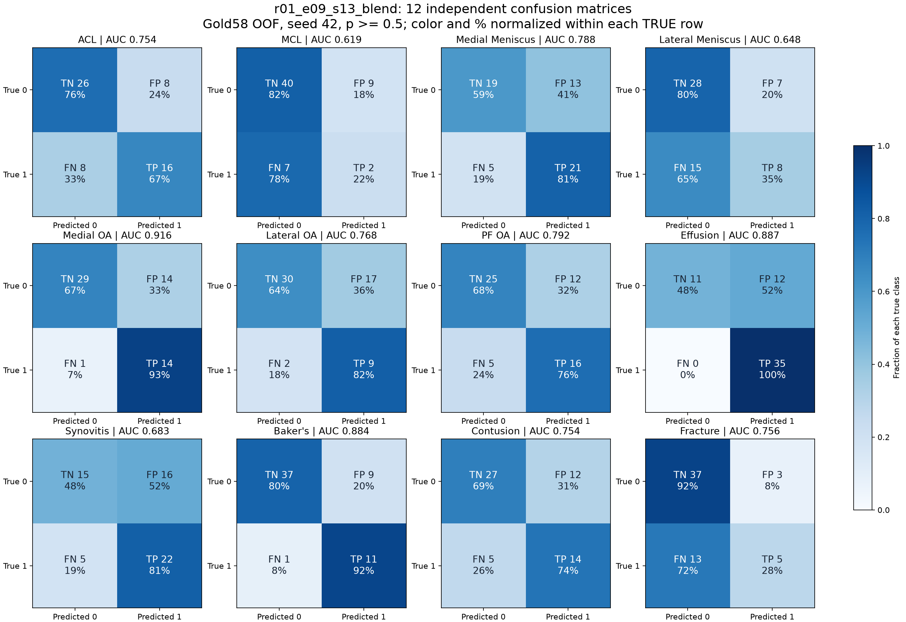

# 33개 실험에서 확인한 것

이 문서의 33개 구성 이후 결과는 [2026-10-23 대회 종료 정리](competition_wrapup_20261023.md)와 [42개 구성 집계](results/2026-10-23/experiment_metrics.csv)에 기록했다. 현재 확인된 최고 Public은 V02 0.805, 개발 OOF는 V00 0.780610이며 두 평가를 구분한다.

2026-10-19에 로컬에 내려받은 **완료된 학습·추론 산출물 33개 구성**을 재검증했다. 학습 config, OOF의 검사·fold 정렬, AUC/BCE, 제출 파일 형식과 학습/추론 manifest를 확인한 뒤 집계했다. 이 페이지의 결과는 개발용 Gold58 OOF이며 공식 리더보드 점수가 아니다.

- [전체 33개 결과 CSV](results/2026-10-19/experiments.csv)
- [실험별 혼동행렬과 재현율·정밀도](results/2026-10-19/confusion_comparison.md)
- [12개 소견별 모든 seed의 집계값](results/2026-10-19/category_metrics_all_seeds.csv)
- [부모 실험 대비 소견별 변화](results/2026-10-19/parent_category_deltas.csv)
- [브라우저로 열어 두 실험 비교](results/2026-10-19/confusion_comparison.html)

## 가장 큰 개선: 약라벨을 통한 감독 신호 확대

E06 gold-only 대조군은 AUC **0.585972**, E07은 **0.741941**였다. E07은 보고서 기반 공개 약라벨 4,292건을 gold 58건과 결합했다. 모델 종류를 바꾸는 것보다 학습에 사용할 감독 신호를 늘리는 효과가 컸다. 약라벨은 사람이 확정한 영상 정답과 구분하고, unknown을 음성으로 취급하지 않는다.

## 입력을 많이 넣으면 항상 유리한가?

동일 계열에서 인접 3장 **0.716563**, 5장 **0.732541**, 10장 **0.724005**였다. 현재 조건에서는 5장이 가장 좋았다. 주변부 비관련 영상, 중복 정보, 학습 용량과 장수 증가의 불균형이 가능한 설명이지만, 이 결과만으로 원인을 확정할 수는 없다. 후속 입력 범위·밀도 실험으로 구분한다.

## Attention과 fine-tuning의 효과

S08 **0.725969**에서 S11 cross-attention **0.736386**으로 개선됐다. 그러나 단순 촬영 조건 구성인 E09 **0.744113**보다 높지는 않았다. S12의 부분 fine-tuning은 **0.718888**로 악화했다. Transformer, attention, fine-tuning이라는 이름만으로 개선을 보장하지 않으며 대조 실험을 기준으로 판단한다.

## 현재 최고 구성과 남은 오류

R01은 E09와 S13을 고정 50:50으로 결합한 앙상블이다. 평균 OOF AUC **0.771432**, seed 표준편차 **0.008916**, 검증 BCE **0.554393**이다. 비교 대상 S13은 AUC **0.748420**이었다. 표준편차는 seed 변동이며 모집단 신뢰구간이 아니다.

혼동행렬은 seed42, 임계값 0.5의 진단 자료다. FN은 실제 소견을 놓친 경우, FP는 없는 소견을 있다고 판단한 경우다. 재현율은 TP/(TP+FN), 정밀도는 TP/(TP+FP)로 계산한다. 임계값을 바꿔 혼동행렬을 개선하는 것과 원래 점수의 AUC를 높이는 것은 다르다.

R04 confidence 필터는 S10과 동일한 **0.739986**이었고, R05 소견별 loss reduction은 **0.734991**이었다. 개선되지 않은 결과도 포함했다. R02/R03/R06 및 조건부 R07, T 위치 실험, U 공간 특징·전체 fine-tuning 실험은 완료 결과와 섞지 않는다. [U 실험 계획과 실제 대기 상태](public_method_experiments.md).

## 재현과 해석의 한계

- 같은 gold 58건을 여러 차례 개발에 사용했다. 3 seeds는 서로 독립인 174명의 검사가 아니다.
- E/S/R의 모든 구성이 같은 학습 조건은 아니다. 부모 실험을 기준으로 비교해야 한다.
- 공개 약라벨 teacher의 gold 독립성은 확인되지 않았다. 별도 독립 평가가 필요하다.
- 실제 Kaggle hidden-test 성능이나 임상적 유효성을 이 결과만으로 주장하지 않는다.
- 저장소에는 집계 결과만 포함한다. 개인별 원본, OOF 예측, 가중치와 실행 상태는 별도 로컬/Kaggle artifact다.

학습부터 실패 분석까지의 과정은 [실험 노트](followup_experiment_results.md), 연구·구현에서 얻은 경험은 [프로젝트 회고](project_purpose_and_learning.md)에 정리했다.
